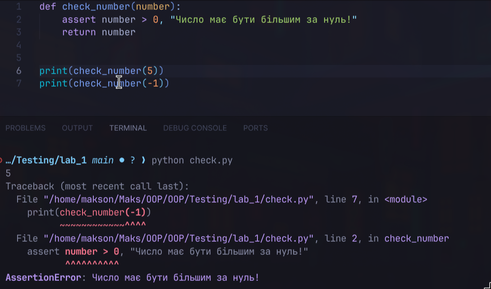
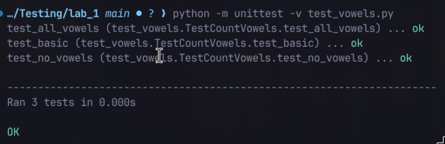
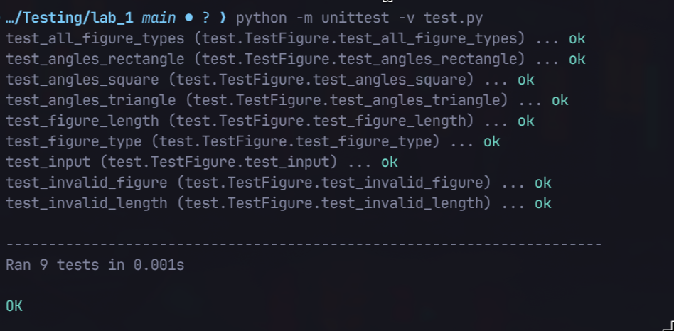

# Звіт до роботи
## Тема: Загальне тестування та юніт-тести
### Мета роботи: _Навчитись писати юніт-тести за допомогою `unittest`, використовувати `assert` для перевірки даних, а також застосовувати `subTest` та `mock` у тестах_;

---
### Виконання роботи

#### Створив файли: `check.py`, `vowels.py`, `test_vowels.py`, та доповнив `app.py` і `test.py`.

#### 1. Перевірка числа через `assert`
Створив файл `check.py` з функцією `check_number`, яка перевіряє що число більше за 0.
- При правильному введенні (`5`) — повертає число
- При неправильному (`-1`) — падає з `AssertionError: Число має бути більшим за нуль!`



#### 2. Функція підрахунку голосних літер
Створив `vowels.py` з функцією `count_vowels` та `test_vowels.py` з трьома тестами:
- `test_basic` — перевіряє звичайний рядок
- `test_all_vowels` — рядок лише з голосних
- `test_no_vowels` — рядок без голосних

Команда запуску:
```bash
python -m unittest -v test_vowels.py
```


#### 3. Додав метод `get_angles` у `app.py`
```python
def get_angles(self) -> int:
    angles = {
        "трикутник": 3,
        "квадрат": 4,
        "прямокутник": 4,
    }
    return angles[self.type]
```

#### 4. Доповнив `test.py` — тести для `get_angles`, `subTest`, `patch`
- `test_angles_square/rectangle/triangle` — перевіряють кількість кутів
- `test_all_figure_types` через `subTest` — перевіряє всі типи фігур в одному тесті, при помилці видно який саме тип не пройшов
- `test_input` через `@patch` — замінює `input()` щоб не вводити дані вручну

Команда запуску:
```bash
python -m unittest -v test.py
```


#### `subTest` дозволяє запустити один тест для кількох наборів даних і точно показує який з них не пройшов, замість того щоб зупинятись на першій помилці.

#### `mock` замінює зовнішні залежності (наприклад `input`) щоб тест не залежав від дій користувача.