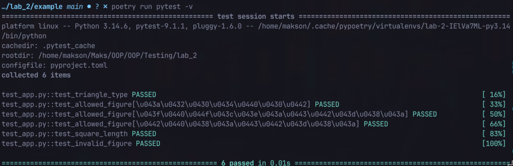
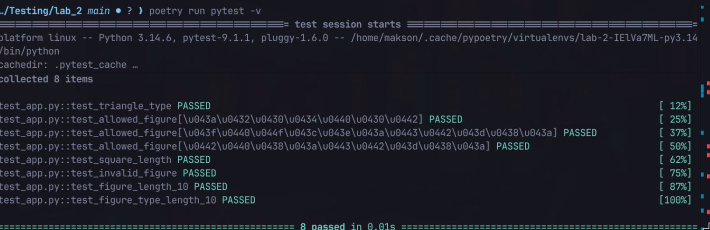
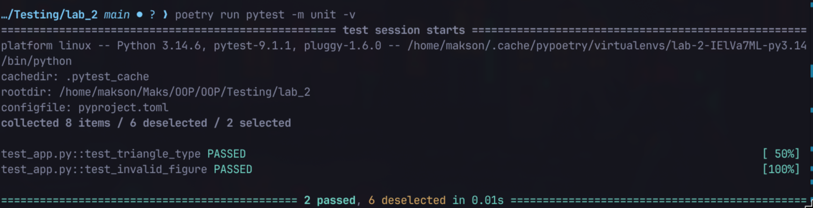
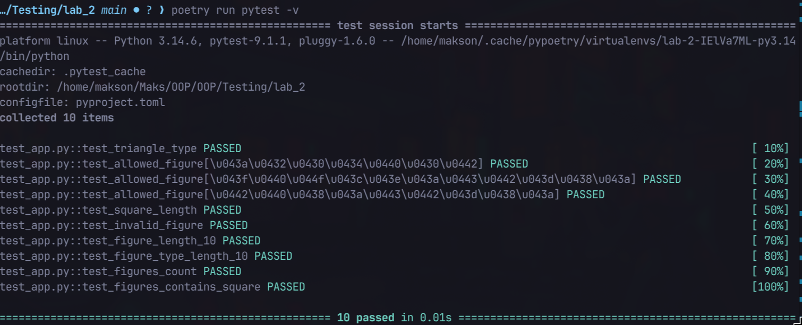

# Звіт до роботи
## Тема: Тестування з бібліотекою pytest
### Мета роботи: _Навчитись писати тести за допомогою pytest, використовувати параметризацію, fixtures та маркери_;

---
### Виконання роботи

#### Встановлення pytest
```bash
poetry add --group dev pytest
```

#### Запуск існуючих тестів
```bash
poetry run pytest -v
```


#### 1. Fixture з довжиною 10
Додав fixture яка повертає фігуру з довжиною 10 та два тести для перевірки її властивостей:
```python
@pytest.fixture
def figure_length_10():
    return Figure("квадрат", 10)

def test_figure_length_10(figure_length_10):
    assert figure_length_10.get_figure_length == 10

def test_figure_type_length_10(figure_length_10):
    assert figure_length_10.type == "квадрат"
```


#### 2. Маркер `unit`
Додав маркер `unit` до двох тестів та зареєстрував його у `pyproject.toml`:
```toml
[tool.pytest.ini_options]
markers = [
    "unit: швидкі юніт-тести",
]
```
Запуск тільки тестів з маркером:
```bash
poetry run pytest -m unit -v
```


#### 3. Fixture зі `scope="module"`
```python
@pytest.fixture(scope="module")
def allowed_figures():
    return Figure.FIGURES

def test_figures_count(allowed_figures):
    assert len(allowed_figures) == 3

def test_figures_contains_square(allowed_figures):
    assert "квадрат" in allowed_figures
```


#### Різниця між `unittest.TestCase` та функцією `pytest`
- `unittest` вимагає клас який наслідує `TestCase` та методи що починаються з `test_`
- `pytest` дозволяє писати прості функції без класу, використовує звичайний `assert` замість `assertEqual`, `assertTrue` тощо

#### Параметризація
Дозволяє виконати один тест для кількох наборів даних:
```python
@pytest.mark.parametrize("figure_type", Figure.FIGURES)
def test_allowed_figure(figure_type):
    assert Figure(figure_type, 1).type == figure_type
```