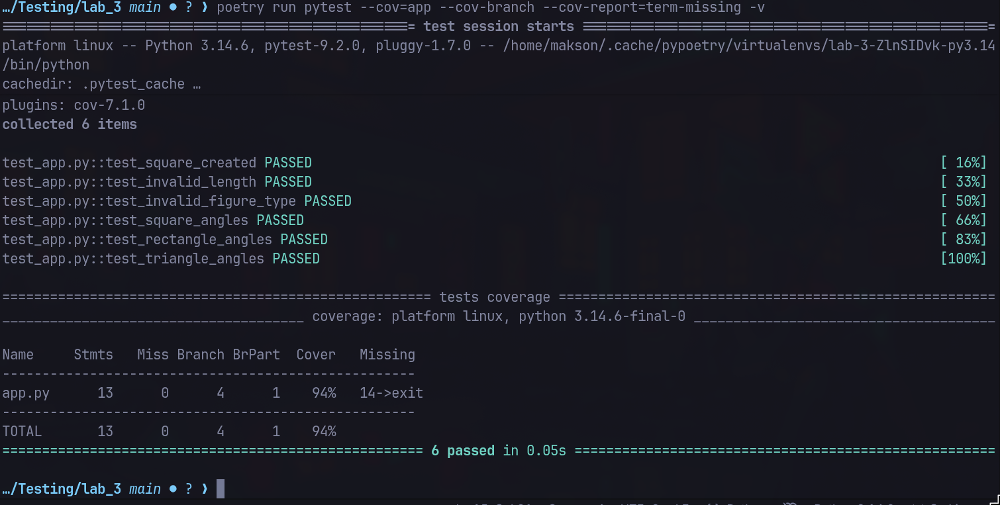
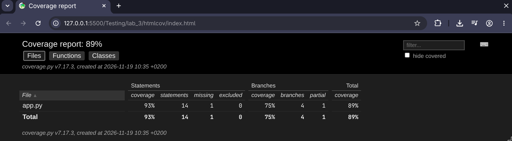

# Звіт до роботи
## Тема: Покриття коду (Coverage)
### Мета роботи: _Навчитись вимірювати покриття коду тестами, використовувати coverage.py та pytest-cov, розуміти різницю між line та branch coverage_;

---
### Виконання роботи

#### Встановлення залежностей
```bash
poetry add --group dev pytest pytest-cov
```

#### Написання тестів
Написав тести для класу `Figure` з `app.py`, які покривають усі гілки:
```python
def test_square_created():
    f = Figure("квадрат", 5)
    assert f.type == "квадрат"
    assert f.length == 5

def test_invalid_length():
    with pytest.raises(AssertionError):
        Figure("квадрат", 0)

def test_invalid_figure_type():
    with pytest.raises(AssertionError):
        Figure("коло", 5)

def test_square_angles():
    assert Figure("квадрат", 5).get_angles == 4

def test_rectangle_angles():
    assert Figure("прямокутник", 5).get_angles == 4

def test_triangle_angles():
    assert Figure("трикутник", 5).get_angles == 3
```

#### Запуск тестів з coverage
```bash
poetry run pytest --cov=app --cov-branch --cov-report=term-missing -v
```


Coverage склав **94%**. Непокрита гілка `14->exit` — це вихід з `@property` після останнього `if`, що є технічним артефактом branch coverage, а не реальною логікою.

#### pragma: no cover
Рядок `return 0` є недосяжним, бо `assert` у `__init__` вже відсіює невідомі типи фігур. Позначив його як виключення:
```python
return 0  # pragma: no cover
```

#### Налаштування .coveragerc
```ini
[run]
source = .
branch = true

[report]
omit =
    test_*.py
    */__init__.py
    */.venv/*
```

#### HTML-звіт
```bash
poetry run coverage html
```


HTML-звіт призначений для людей — зручно переглядати у браузері, підсвічує непокриті рядки. XML-звіт (`coverage xml`) призначений для CI-систем та сервісів аналізу покриття.

#### Різниця між line та branch coverage
- **Line coverage** — показує чи виконувався рядок хоча б раз
- **Branch coverage** — показує чи пройшли тести кожен напрямок умовного переходу (`if/else`). Наприклад, якщо протестувати лише трикутник — рядок з `return 4` виконається, але гілка для квадрата і прямокутника залишиться непокритою за branch coverage

#### Чого coverage не доводить
100% line coverage не означає відсутності помилок. Тест який викликає функцію без `assert` збільшує відсоток покриття, але не перевіряє правильність результату.

#### .gitignore
```
__pycache__/
.coverage
htmlcov/
.pytest_cache/
```