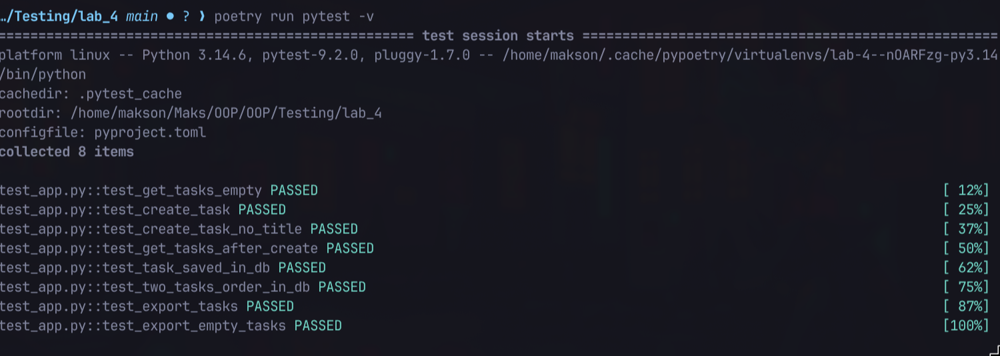

# Звіт до роботи
## Тема: Інтеграційне тестування
### Мета роботи: _Навчитись писати інтеграційні тести для Flask-застосунку, тестувати взаємодію HTTP-маршрутів, SQLite бази даних та файлової системи_;

---
### Виконання роботи

#### Встановлення залежностей
```bash
poetry add --group dev flask pytest
```

#### Структура застосунку
`app.py` містить:
- `init_db` — створює таблицю `tasks` у SQLite
- `export_tasks` — експортує завдання у JSON-файл
- `GET /tasks` — повертає список завдань
- `POST /tasks` — створює нове завдання

#### Fixtures
```python
@pytest.fixture
def db_path(tmp_path):
    path = str(tmp_path / "test.db")
    init_db(path)
    return path

@pytest.fixture
def client(db_path, monkeypatch):
    monkeypatch.setattr("app.DB_PATH", db_path)
    app.config["TESTING"] = True
    with app.test_client() as client:
        yield client
```
`tmp_path` — вбудована pytest fixture яка створює тимчасову папку, що автоматично видаляється після тесту. `monkeypatch` підміняє `DB_PATH` на тимчасову базу, щоб тести не торкались робочих даних.

#### HTTP тести
Перевірка статусів відповідей та вмісту JSON:
```python
def test_create_task(client):
    response = client.post("/tasks", json={"title": "Вивчити Flask"})
    assert response.status_code == 201

def test_create_task_no_title(client):
    response = client.post("/tasks", json={})
    assert response.status_code == 400
```

#### SQLite тести
Перевірка що дані реально зберігаються в базі:
```python
def test_task_saved_in_db(client, db_path):
    client.post("/tasks", json={"title": "Перевірка БД"})
    conn = sqlite3.connect(db_path)
    cursor = conn.execute("SELECT title FROM tasks")
    rows = cursor.fetchall()
    conn.close()
    assert rows[0][0] == "Перевірка БД"
```

#### JSON експорт тести
Перевірка що `export_tasks` коректно записує дані у файл:
```python
def test_export_tasks(client, db_path, tmp_path):
    client.post("/tasks", json={"title": "Експорт"})
    filepath = str(tmp_path / "tasks.json")
    export_tasks(filepath, db_path)
    with open(filepath, encoding="utf-8") as f:
        data = json.load(f)
    assert data[0]["title"] == "Експорт"
```

#### Запуск тестів
```bash
poetry run pytest -v
```


#### Різниця між юніт- та інтеграційним тестом
- **юніт-тест** — перевіряє одну функцію ізольовано, залежності замінюються mock-об'єктами
- **інтеграційний тест** — перевіряє спільну роботу кількох компонентів: HTTP-маршрут → бізнес-логіка → SQLite → файлова система
- у цій роботі не використовуються mock-об'єкти — тест працює з реальною (тимчасовою) базою та файловою системою

#### Взаємодія компонентів у тестах
| Тест | Компоненти |
|------|-----------|
| `test_create_task` | HTTP → SQLite |
| `test_get_tasks_after_create` | HTTP → SQLite → HTTP |
| `test_task_saved_in_db` | HTTP → SQLite (пряма перевірка) |
| `test_export_tasks` | HTTP → SQLite → JSON-файл |
| `test_export_empty_tasks` | SQLite → JSON-файл |