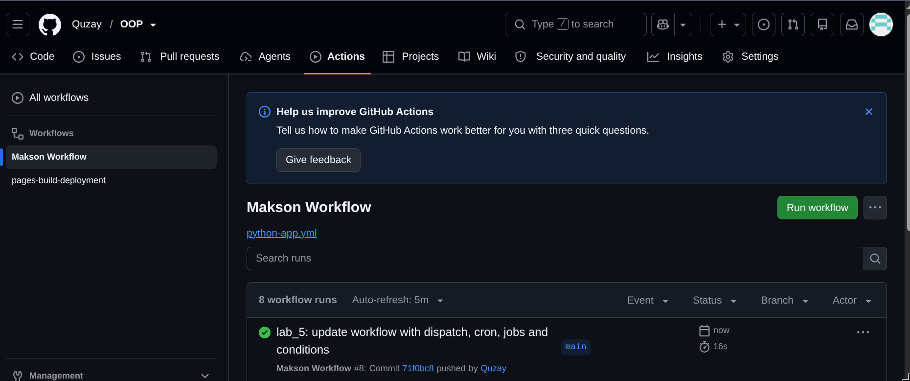
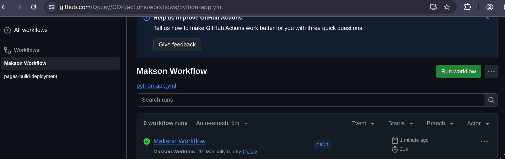
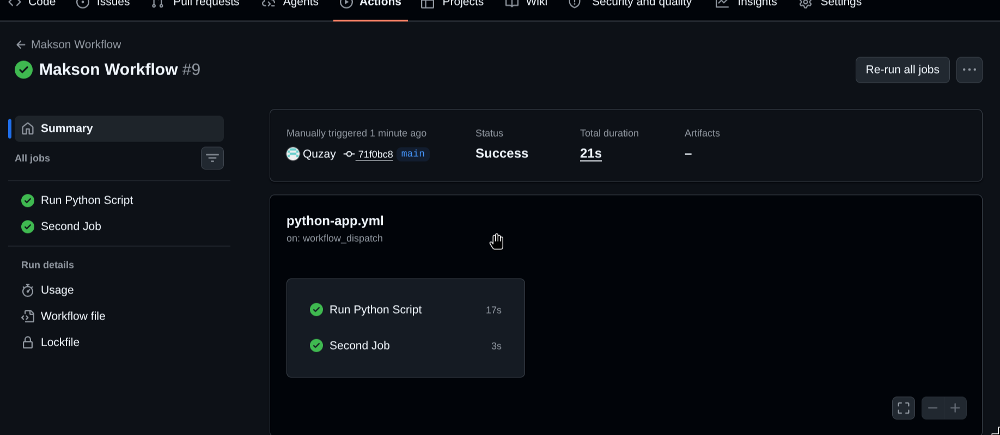
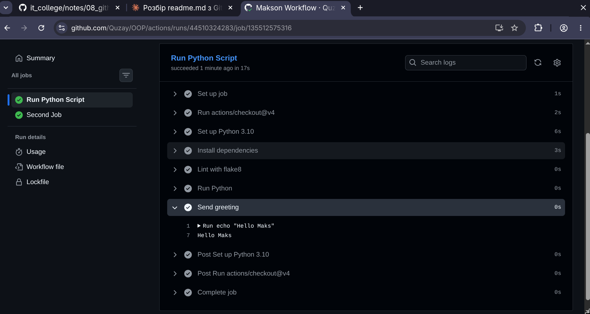
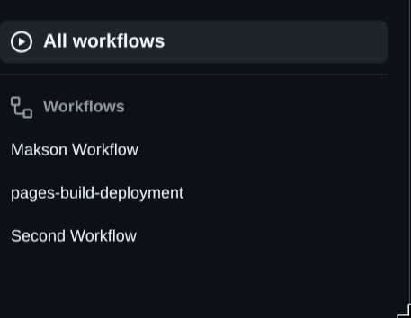
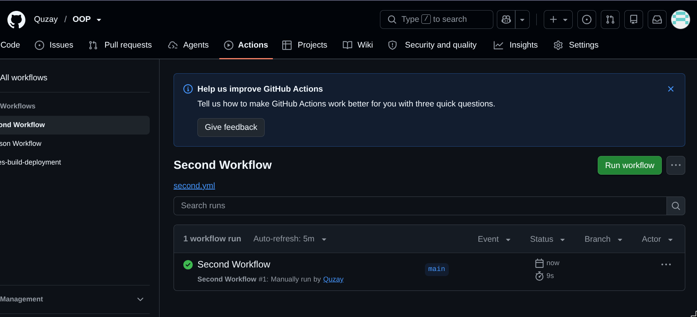

# Звіт до роботи
## Тема: Автоматизація за допомогою GitHub Actions
### Мета роботи: _Навчитись налаштовувати CI/CD pipeline за допомогою GitHub Actions, створювати workflow з різними тригерами, jobs та умовами_;

---

[](https://github.com/Quzay/OOP/actions/workflows/python-app.yml)
[](https://github.com/Quzay/OOP/actions/workflows/second.yml)

---
### Виконання роботи

#### 1. Створення першого Workflow з шаблону
Створив workflow з шаблону `Python application` через вкладку `Actions` → `New workflow`. Змінив назву на `Makson Workflow` та закомітив файл.



#### 2. Запуск вручну (workflow_dispatch) з параметром
Додав тригер `workflow_dispatch` з параметром `name`. При ручному запуску передається імʼя користувача:
```yaml
workflow_dispatch:
  inputs:
    name:
      description: 'Імʼя користувача'
      default: 'Executer'
      required: true
```


#### 3. Запуск по розкладу (cron)
Додав тригер `schedule` з запуском щопонеділка о 10:00:
```yaml
schedule:
  - cron: '0 10 * * 1'
```

#### 4. Два jobs в одному workflow
```yaml
jobs:
  run_python:
    name: Run Python Script
  second_job:
    name: Second Job
```


#### 5. Умова if для кроку
Крок `Send greeting` виконується лише якщо передане імʼя не є `Executer`. При запуску з імʼям `Maks` — крок виконався і вивів `Hello Maks`:
```yaml
- name: Send greeting
  run: echo "Hello ${{ github.event.inputs.name }}"
  if: github.event.inputs.name != 'Executer'
```


#### 6. Два окремих Workflow
Створив два файли — `python-app.yml` та `second.yml` з різними назвами. Обидва відображаються у вкладці `Actions`:





#### 7. Баджі в README
Додав баджі статусу обох workflow у `README.md` репо.